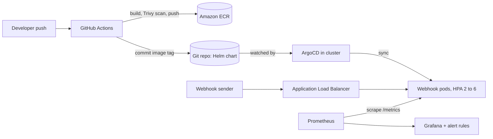
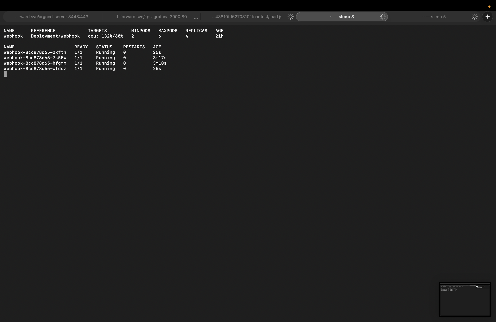
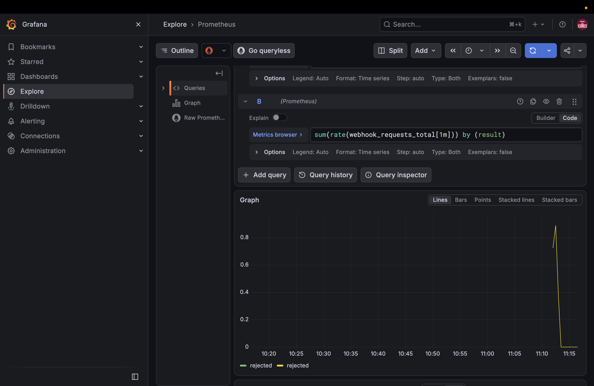
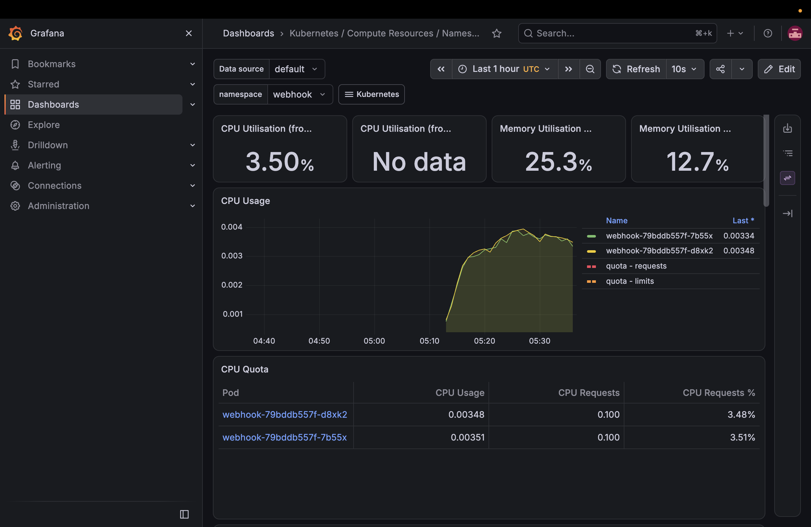

# EKS Webhook Platform

A production-style deployment of a NestJS webhook receiver on AWS EKS, built end to end with Terraform, Helm, GitHub Actions and ArgoCD, with Prometheus and Grafana monitoring. Based on my experience running WhatsApp webhook integrations.

## Architecture

## What it includes

- **Terraform:** custom VPC (public/private subnets, single NAT), EKS cluster with a managed node group, ECR with immutable tags and scan-on-push, EKS Pod Identity role for the AWS Load Balancer Controller, remote state in S3 with native locking, least-privilege CI user (ECR push only).
- **Kubernetes / Helm:** Deployment with probes, resource requests and limits, non-root and dropped capabilities, HPA (2 to 6 replicas, 60% CPU), PodDisruptionBudget, topology spread, ALB Ingress exposing only `/webhook` and `/healthz` (`/metrics` stays internal), graceful shutdown (preStop delay plus termination grace period).
- **CI/CD:** GitHub Actions builds the image, fails the pipeline on HIGH/CRITICAL findings (Trivy), pushes to ECR, and commits the new image tag. ArgoCD (automated sync, self-heal, prune) deploys it, with no manual deploy step.
- **Observability:** kube-prometheus-stack, a ServiceMonitor for the app's custom `webhook_requests_total` metric, and alert rules (`WebhookDown`, `WebhookRejectedSpike`) managed in the Helm chart.

## Measured results

| Test | Result |
|---|---|
| Load test (k6, ramp to 200 virtual users, 3 min, 2 replicas, 100m CPU request) | 63,486 requests, 0 failed, about 352 req/s, p95 352 ms (measured from India to ap-southeast-2) |
| Autoscaling (CPU request right-sized to 25m after measuring idle use at 4 to 16m per pod) | HPA scaled 2 to 4 to 5 to 6 replicas in about 45 seconds and reached the configured maximum |
| Pod deleted during 30 req/s traffic, before fix | 9 of 2,700 requests failed (0.33%), slowest request 10.31 s |
| Same test after preStop delay and grace period | 0 of 2,701 failed, slowest request 468 ms |

These are single runs, and the before and after tests ran at different replica counts (6 and 2), so treat them as indicative, not a benchmark.

## Screenshots

**Autoscaling under load:** HPA at 132% of the 60% CPU target with 4 replicas (scaled up from 2); two pods are seconds old.

**Custom application metric in Grafana:** `webhook_requests_total` by result, scraped through the ServiceMonitor.

**Pod CPU and memory (namespace webhook) at idle, before right-sizing:**

## Decisions and limitations

- Built in a sponsored, organization-managed AWS account whose policies block creating an IAM OIDC provider. So IRSA and GitHub OIDC were not possible: pods use EKS Pod Identity, and CI uses a scoped IAM user with keys stored as GitHub secrets. In my own account I would use GitHub OIDC for CI.
- The same policies restrict regions, so everything runs in ap-southeast-2.
- Prometheus has no persistent volume (demo setup). Data is lost on restart.
- One NAT gateway and two worker nodes to control cost; not highly available at the NAT layer.
- The ALB listens on HTTP only. A real deployment needs an ACM certificate and HTTPS.
- Initial CPU request of 100m never triggered the HPA under load. I measured actual use and right-sized it to 25m so scaling could be demonstrated; this value is specific to this tiny app.
- A Trivy gate caught vulnerabilities in transitive dependencies (body-parser, multer); fixed with npm `overrides`, and the runtime image uses Node 24 with npm removed.

## Reproduce

1. `cd terraform && terraform init && terraform apply` (create the S3 state bucket first; see `backend.tf`).
2. `aws eks update-kubeconfig --name eks-webhook --region ap-southeast-2`
3. Install the AWS Load Balancer Controller, ArgoCD and kube-prometheus-stack with Helm, then `kubectl apply -f gitops/webhook-app.yaml`.
4. Create the `webhook-secret` Kubernetes secret and the GitHub Actions secrets.
5. Run `k6 run -e ALB=<alb-host> -e SECRET=<secret> loadtest/load.js`.
